# 操作手冊：桌面版與 CLI

用 `domjudge-tool` 管理 DOMjudge 使用者、隊伍、題目套件、排行榜、繳交原始碼
及帳號通知信。本手冊依操作任務編排；完整旗標表以 [CLI 參考](CLI.zh-TW.md)
為準，[CLI 範例](SNIPPETS.zh-TW.md) 提供其他指令用法。

[English edition](USER_GUIDE.md) · [快速開始](../README.md)

| 操作目標 | 閱讀章節 |
| --- | --- |
| 第一次安裝及連線 | 第 1–3 節 |
| 準備或移除競賽帳號 | 第 4–7 節 |
| 搬移題目及收集競賽資料 | 第 8–11 節 |
| 安全寄送帳號資料 | 第 12 節，再讀第 14 節 |
| 排查結果或尋找本機資料 | 第 13–15 節 |

## 1. 開始前先確認

### 1.1. 環境需求與支援版本

- 使用 DOMjudge **7.3.x** 或 **8.3.1** 伺服器。填寫伺服器的實際版本，例如
  `7.3.2` 或 `8.3.1`；這個值決定相容的 jury 頁面實作。不要據此推定其他版本
  也受支援。
- 取得已授權的 DOMjudge 帳號。讀取使用者需要 API 權限；修改帳號、刪除資料及
  下載題目 ZIP 也需要相應的 jury 頁面權限。API 讀取成功，不代表帳號有所有
  寫入權限。
- 向競賽管理者確認競賽 ID。盡量使用數字 ID；排行榜 CLI 的 `--cid` 接受數字。
- 準備私人且可寫入的本機資料夾，存放設定、帳密 CSV、匯出資料、題目套件及
  郵件。這些檔案可能包含機密資料。
- 使用已發布的 CLI 執行檔不需要 Go。從原始碼建置需要
  [mise](https://mise.jdx.dev/)，由它安裝固定版本的 Go **1.27.3** 及其他工具；
  儲存庫任務使用 `mise run`。桌面預覽版另需原生 CGO 工具鏈及作業系統的原生 GUI
  環境。macOS 應用程式套件的打包任務僅能在 macOS 執行。

CLI 適合腳本操作。桌面版以相同操作套件提供原生預覽介面、表單及本機 History。
這兩個介面都不負責安裝或維護 DOMjudge 伺服器本身。

### 1.2. 分清楚哪些操作會改動資料

| 操作 | 影響 |
| --- | --- |
| 產生設定、CSV 範本或郵件範本 | 寫入本機檔案，不修改 DOMjudge |
| 匯出使用者、下載題目、排行榜或繳交內容 | 讀取 DOMjudge，並將資料寫入本機 |
| 驗證或轉出郵件 | 讀取本機輸入；轉出郵件會寫入 `.eml`，不連線 SMTP |
| 匯入使用者、重設密碼或匯入題目 | 執行時立即修改 DOMjudge |
| 勾選 Dry-run 的 Remove Users | 讀取快照並預覽預計移除的項目 |
| 未勾選 Dry-run 的 Remove Users 或 CLI 移除指令 | 永久刪除遠端使用者與隊伍 |
| Send Emails 或 SMTP CLI 指令 | 寄出包含帳號資料的真實郵件 |

> 匯入、重設密碼、刪除、更新題目及 SMTP 寄送都會實際執行。先在已授權的測試站
> 操作，再處理正式環境。工具沒有通用交易、自動回復或復原按鈕。批次操作失敗時，
> 前面的資料列可能已完成修改，前面的郵件也可能已寄出。

所有指令範例都使用保留網域及範例身分。請只在私人本機檔案替換實際值。
`REPLACE_LOCALLY` 是佔位值，不能當成真實密碼。不要提交真實設定、帳密、帳號 CSV、
繳交原始碼、轉出的郵件或正式環境截圖。

### 1.3. 圖片呈現的範圍

本手冊所有圖片都是**桌面 HTML 預覽**，由隔離預覽伺服器 `127.0.0.1:9901`
以 **1280 × 1000** 擷取，資料僅含保留範例。預覽使用桌面版範本並模擬操作，
不代表遠端匯入、刪除、密碼重設、下載或 SMTP 寄送成功，也不呈現原生檔案對話框。
真實桌面版使用 `127.0.0.1:9900`。

兩個語言版本都保留英文介面標籤。圖片說明操作位置；文字說明真實行為及限制。
截圖產製規範請見[文件規範](DOCUMENTATION.md)。

## 2. 安裝與啟動

### 2.1. 啟動 CLI

從 [Releases](https://github.com/ntub/domjudge-tool/releases) 下載符合
作業系統及架構的封存檔，解壓縮後將 `domjudge-tool` 加入 `PATH`。也可以從
原始碼安裝：

```bash
go install github.com/ntub/domjudge-tool/cmd/domjudge-tool@latest
domjudge-tool --help
domjudge-tool version
```

在儲存庫工作目錄建置，並讓目前終端機使用這份工作目錄的 CLI：

```bash
mise install
mise run setup
mise run build
./bin/domjudge-tool --help
./bin/domjudge-tool version
export PATH="$PWD/bin:$PATH"
```

`mise install` 安裝固定版本的工具鏈。`mise run setup` 下載 Go 模組與前端套件，
並安裝 Git hooks。後續範例假設目前位於儲存庫工作目錄，且 `domjudge-tool`
已在 `PATH`。使用已安裝執行檔的人，可將 `tmp/operator` 換成自己的私人工作資料夾。

`version` 顯示工具的建置版本，不會測試伺服器連線。使用
`domjudge-tool <command> --help` 查看已安裝執行檔支援的旗標。進度及診斷紀錄
寫到 stderr；未指定輸出檔的匯出資料寫到 stdout。腳本可用 `--no-progress`
關閉進度顯示。

### 2.2. 啟動桌面版或 macOS 應用程式套件

在工作目錄執行：

```bash
mise run build-desktop
./bin/domjudge-tool-app
```

macOS 可打包並開啟應用程式套件，取代直接執行原始執行檔：

```bash
mise run package-desktop
open ./bin/domjudge-tool.app
```

套件包含應用程式圖示。打包只建立本機套件，不代表已簽章、通過公證或安裝到
Applications。原生視窗起始大小為 1280 × 800，最小為 **800 × 560**。
可調整視窗大小，或捲動內容及側邊欄以找到控制項。鍵盤操作可按 Tab 移至
**Skip to content**。

桌面版使用固定的本機連接埠，同一時間只啟動一個執行個體。服務應維持在 loopback，
不要用 proxy 或 tunnel 對外公開 9900 連接埠。本機介面不提供多人共用的管理服務。

來源：[建置任務](../mise.toml)、
[`cmd/desktop/main.go:27`](../cmd/desktop/main.go#L27)、
[`cmd/desktop/main.go:94`](../cmd/desktop/main.go#L94)。

### 2.3. 安裝套件附帶的 CLI 指令

桌面套件包含獨立 CLI。安裝指令後，不必讓桌面版持續執行；這項功能不提供 TUI，
也不會讓 CLI 共用桌面版的連線設定資料庫。

用 `mise run package-desktop` 建置目前平台的套件。macOS 應用程式位於
`bin/domjudge-tool.app`；Linux 與 Windows 的可攜式目錄位於
`bin/desktop/domjudge-tool`。壓縮檔與 SHA-256 校驗碼寫入 `dist/desktop`。
每個版本 tag 的 Release 會附上 macOS、Linux、Windows 的 amd64 與 arm64
未簽章套件；下載套件不代表已安裝。Linux 需要 GTK4、WebKitGTK 6.0 與相關
系統函式庫，建置基準為 Ubuntu 24.04。Windows 需要 WebView2。

1. 將符合平台的套件解壓至固定、目前使用者可寫入的位置，保留完整目錄。
   macOS 請先移動 `.app` 再開啟；App Translocation 位置不允許安裝指令。
2. 在套件應用程式開啟 **Settings**，找到 **Command-Line Tool** 卡片。確認套件
   CLI 版本、**User Command Path** 及 **This App's CLI** 後，勾選
   **I confirm** 核取方塊，再選擇 **Install CLI**。
3. 依 **Manual PATH Setup and Command Lookup** 的說明設定 PATH，或直接執行
   畫面顯示的完整指令路徑。應用程式不會修改 PATH、shell 啟動檔或 Windows
   registry，也無法檢查其他終端機的 PATH、alias 或指令快取。
4. 在設定好的終端機執行 `domjudge-tool --help` 與 `domjudge-tool version`。
   CLI 操作仍需另外建立 `domserver.json`。

| 平台 | 目前使用者的指令 | 實作方式 |
| --- | --- | --- |
| macOS / Linux | `~/.local/bin/domjudge-tool` | 經過私人狀態目錄的 symlink，連至套件內 CLI |
| Windows | `%LOCALAPPDATA%\domjudge-tool\cli-install\bin\domjudge-tool.exe` | 指向套件內 CLI 的原生 console 轉發程式 |

每個操作都必須勾選各自的確認核取方塊。開啟 Settings 後若整合狀態已變動，
操作會被拒絕；請重新檢查目前路徑後再確認。在原位置替換完整應用程式，CLI
目標會跟著更新。Windows 替換檔案前，請關閉執行中的相關程式。移動應用程式後，
從新位置開啟並選擇 **Relink CLI to This App**。另一份應用程式不會自動接管指令。
刪除應用程式會留下失效的指令；目標不存在時會明確失敗，Windows 轉發程式
不會改執行 PATH 上的其他同名指令。

**Uninstall CLI Integration** 只移除可驗證由應用程式管理的指令整合，不會刪除
桌面版、連線設定、CLI 設定檔或其他來源的 CLI。遇到外來檔案、被修改的轉發程式、
過期表單或權限問題時，會顯示錯誤，不強制覆寫或提權。
若 PATH 優先找到另一份指令，請先確認其來源再調整。
HTML 預覽及缺少套件 metadata 的原始開發執行檔不提供安裝功能。

## 3. 連線到正確伺服器

### 3.1. 分開管理 CLI 設定與桌面連線設定

| 介面 | 連線資料儲存位置 | 選擇目標的方法 |
| --- | --- | --- |
| CLI | 明文 JSON，預設為工作目錄的 `domserver.json` | 用 `--config` / `-c` 明確指定檔案 |
| 桌面版 | 儲存在應用程式本機 SQLite 資料庫的 profiles | 每個操作表單都要選擇 **Server Profile** |

建立其中一種設定，不會建立或更新另一種。桌面版啟動時不會自動匯入 CLI 的
`domserver.json`。桌面 SMTP 設定也與 CLI 的 SMTP 旗標分開。

建立私人 CLI 設定，再送出唯讀的伺服器請求：

```bash
umask 077
mkdir -p tmp/operator
domjudge-tool gen-config \
  --host https://test-station.example.org \
  --username admin --password 'REPLACE_LOCALLY' \
  --version 8.3.1 --contest-id 1 \
  -o tmp/operator/domserver.json

domjudge-tool -c tmp/operator/domserver.json export-users \
  -o tmp/operator/users-before.csv
```

`gen-config` 寫入本機檔案，不連線 DOMjudge；指定路徑已有檔案時可能覆寫。
匯出指令讀取伺服器並寫入指定 CSV。設定以明文儲存密碼；旗標中的密碼也可能
出現在 shell 歷史紀錄或程序參數。請遵循組織核准的本機機密處理程序。

保持 TLS 憑證驗證開啟。修正憑證或信任設定，不要在正式站用 `--disable-ssl`
繞過問題。完整設定欄位說明請見 [CLI 參考](CLI.zh-TW.md)。

### 3.2. 新增桌面伺服器連線設定

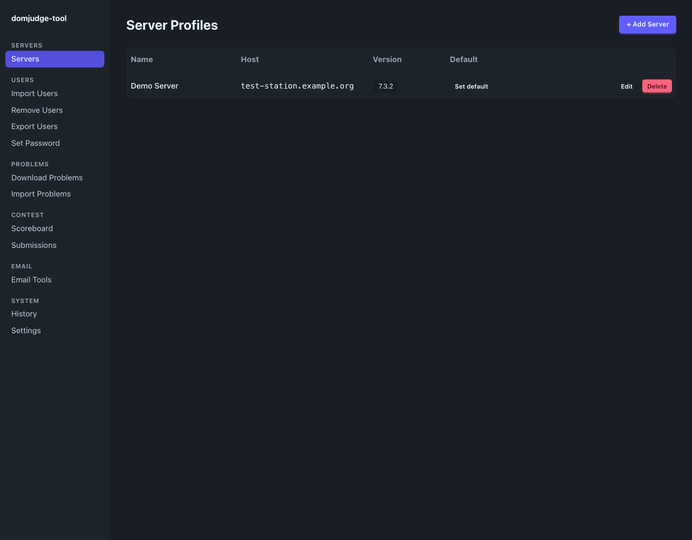

*桌面 HTML 預覽：Servers 列出已儲存的連線設定及本機操作；圖中的主機使用保留網域。*

1. 開啟 **Servers**，選擇 **+ Add Server**。
2. 填入不重複的 **Profile name**、**Host URL**、**Username** 及 **Password**。
   Host 使用基底網址，例如 `https://test-station.example.org`。
3. 將 **DOMjudge version** 設為實際版本。需要依競賽操作時，填入 **Contest ID**。
   保持 **Disable SSL verification** 未勾選。
4. 選擇 **Add**。畫面回到清單，顯示 **Server profile created.**

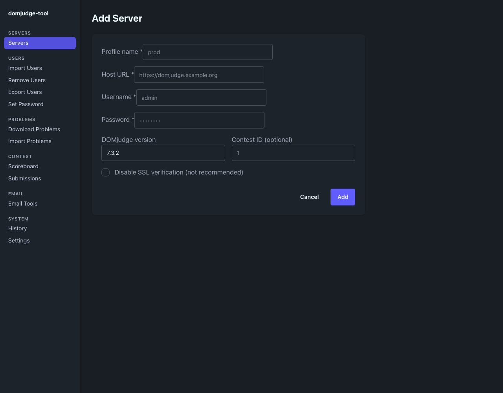

*桌面 HTML 預覽：連線表單將帳密儲存在本機。儲存表單不會測試連線或權限。*

儲存後，先用 **Export Users** 做唯讀檢查。設定出現在清單，只代表本機資料
已儲存。

### 3.3. 設定預設、編輯或刪除連線設定

- **Set default** 將清單的 `default` 標記移至該設定，並顯示
  **Default server updated.** 各操作表單仍要明確選擇 profile；標記不保證
  自動帶入目標。
- **Edit** 開啟已儲存的連線欄位。確認主機、版本、競賽及密碼後再按 **Save**。
  成功訊息為 **Server profile saved.**
- **Delete** 開啟應用程式內的 **Delete Server Profile** 確認視窗。
  **Cancel** 或 Escape 可關閉；**Delete Profile** 移除本機連線設定，並顯示
  **Server profile deleted.** 這項操作不刪除 DOMjudge 上的帳號或競賽資料。
  已刪除的帳密沒有內建還原操作。

Settings 的 **Default Server Profile** 偏好設定，與 Servers 清單的預設標記
分開儲存。執行寫入前，仍要檢查當次操作選取的目標。

來源：[`internal/desktop/handler/profiles.go:14`](../internal/desktop/handler/profiles.go#L14)、
[`internal/desktop/templates/profiles.templ:89`](../internal/desktop/templates/profiles.templ#L89)、
[`cmd/desktop/run_import.go:64`](../cmd/desktop/run_import.go#L64)。

## 4. 匯入使用者與隊伍

### 4.1. 準備 CSV 及帳密交付方式

在本機產生輸入範本：

```bash
domjudge-tool import-users-teams-example \
  -o tmp/operator/import-users-teams.csv
```

**匯入前，完整替換產生的示範資料列。** 保留標準標頭，並以 UTF-8 CSV 儲存。
工具接受 UTF-8 BOM。例如，下列保留範例資料列會要求產生密碼：

```csv
username,name,email,affiliation,password,category_id
user1,Example Team A,user1@example.org,Example Organization,,1
user2,Example Team B,user2@example.org,Example Organization,,1
```

- `username` 及 `name` 必須存在且不能留白；同一檔案的使用者名稱不能重複。
  用試算表編輯時，將使用者名稱保留為文字。
- 前五欄維持 `username,name,email,affiliation,password`。`category_id` 是
  僅供輸入使用的選填逐列覆寫值；留白時使用 CLI 或設定的備用值。
- 非空白的 `affiliation` 會用來查找或建立所屬機構。空白時，若有設定機構 ID，
  就使用該值。
- `password` 留白時由**匯入器**產生密碼。匯入已存在的使用者名稱，通常會更新
  隊伍、帳號及密碼；重複匯入會實際修改資料。
- 每列描述匯入器使用的帳號與隊伍對應。沒有可自由指定的 `team` 欄位；不要依
  表單的簡略格式提示新增該欄。未知或重複的欄名會被拒絕。

> **匯入前**先決定如何保留產生的密碼。CLI 成功後會寫出帳密 CSV。桌面匯入目前
> 只顯示摘要，**不會**提供這份 CSV，也不顯示產生的密碼。需要交付帳密時，優先
> 使用 CLI。若從桌面匯入，請預先填入並私下保留明確密碼，或於匯入後逐一重設。

### 4.2. 從桌面版匯入

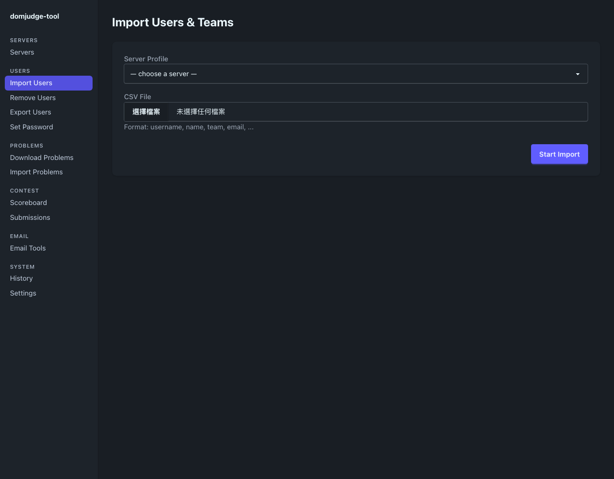

*桌面 HTML 預覽：實際匯入前先選 profile 及 CSV；預覽中的模擬結果不代表
伺服器已完成寫入。*

1. 開啟 **Import Users**，明確選擇目標 **Server Profile**。
2. 選擇準備好的 **CSV File**。
3. 確認已授權這次遠端寫入後，按一次 **Start Import**。
4. 保持進度頁開啟，直到顯示完成或失敗。成功結果會列出已處理、新增及更新的
   資料列數。
5. 開啟 **History** 查看摘要。交付帳密前，另到 DOMjudge 確認目標使用者及隊伍。

桌面版使用已儲存的 profile 及預設匯入選項。這個表單沒有提供忽略既有帳號、
先刪除再建立或密碼產生設定等進階 CLI 控制。進度數字本身不能證明所有目標帳號
都能正常使用。

### 4.3. 用 CLI 匯入並保留輸出

以下操作**會修改 DOMjudge**。子 shell 讓固定名稱的輸出檔留在私人操作資料夾：

```bash
(
  cd tmp/operator
  domjudge-tool -c domserver.json import-users-teams import-users-teams.csv
)
```

成功後，CLI 印出 **Import summary:**，包含新增、更新、略過及機構統計，並寫入
`tmp/operator/import-users-teams-out.csv`。輸出標頭為：

```csv
username,name,email,affiliation,password,is_exist
```

這份檔案包含實際使用或產生的明文密碼，可作為帳密通知郵件的輸入，格式與
**Export Users** 不同。`category_id` 不會出現在輸出。下次成功匯入可能覆寫同名
檔案；再次操作前，先保留經授權的私人副本。

對既有帳號使用 `--ignore-existing` 會略過更新。`--new-password` 會重新產生
密碼，包含 CSV 已提供密碼的資料列。`--delete-existing` 會先刪除再建立，具有
破壞性，且不能與 `--ignore-existing` 同時使用。使用前請查閱
[CLI 細節](CLI.zh-TW.md)。匯入失敗時，前面的伺服器變更可能已生效；失敗的執行
不會產生完整的成功帳密 CSV。

來源：[`internal/importer/parse.go:14`](../internal/importer/parse.go#L14)、
[`internal/cli/users/import_users_teams.go:103`](../internal/cli/users/import_users_teams.go#L103)、
[`cmd/desktop/run_import.go:42`](../cmd/desktop/run_import.go#L42)。

## 5. 安全移除使用者與隊伍

### 5.1. 預覽桌面版移除計畫

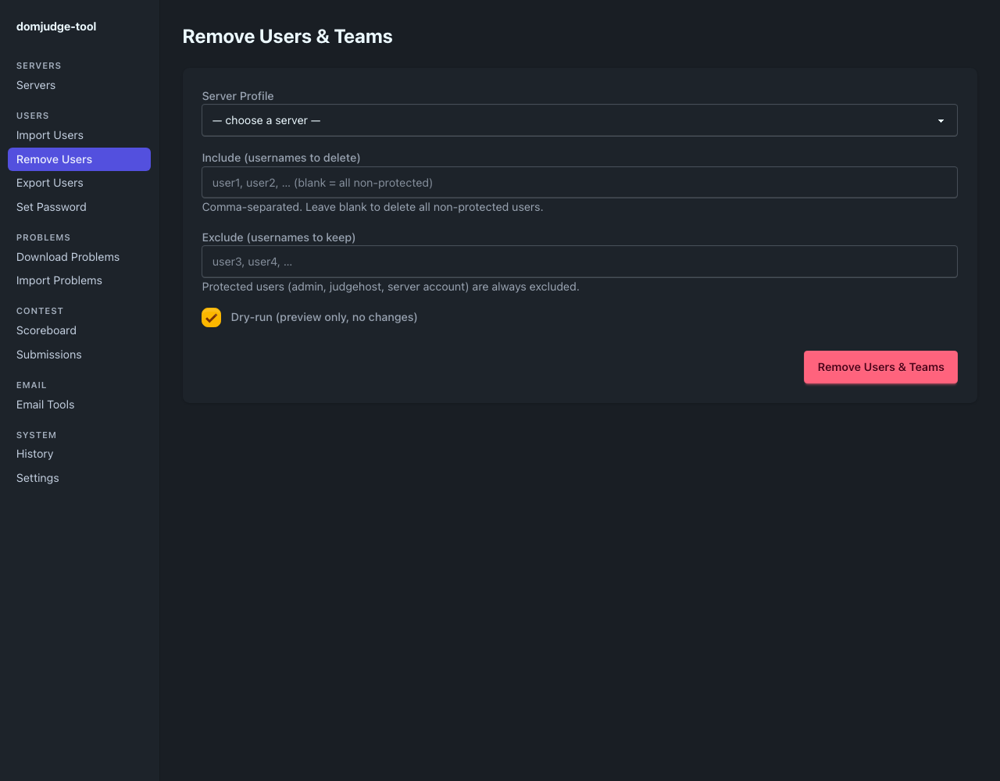

*桌面 HTML 預覽：Dry-run 初始為勾選。取消勾選後，通過應用程式確認即可執行
無法復原的操作。*

1. 開啟 **Remove Users**，選擇正確的目標 profile。
2. 在 **Include** 只選取要刪除的使用者名稱。載入後的選項會顯示為標籤；移除
   標籤即可取消該選取。API 查詢失敗時，改在備用文字欄輸入逗號分隔的使用者名稱。
3. 在 **Exclude** 指定要保留的使用者。**Include 留白代表所有未受保護使用者**，
   再套用 Exclude；留白不代表沒有目標。
4. 保持 **Dry-run (preview only, no changes)** 勾選，按
   **Remove Users & Teams**。
5. 閱讀 **Dry-run: would delete …**、使用者名稱清單及 History 詳情。檢查關聯
   隊伍，並做好適當的伺服器備份。

此移除流程會保護 `admin`、`judgehost` 及連線 profile 的使用者名稱。
Exclude 優先於 Include。即使有保護機制，仍要確認隊伍關聯與完整影響範圍。

### 5.2. 執行已授權的移除

回到表單，重新選取相同的 profile 及篩選條件。確認計畫後，才取消勾選
**Dry-run**。送出表單會開啟自訂的 **Permanently Delete Users & Teams?**
確認視窗。按 **Cancel** 或 Escape 不會送出表單；按 **Permanently Delete**
才開始遠端刪除。

保持進度頁開啟。完成後，另行匯出剩餘使用者，並查看 jury 的使用者及隊伍頁面。
顯示的數量來自選取的資料快照，沒有逐筆重新讀取已刪除物件來稽核。若預覽後
伺服器資料已變動，原計畫可能過期。

### 5.3. CLI 對應操作：刪除沒有 dry-run

先重新執行唯讀匯出，並在私人環境檢查：

```bash
domjudge-tool -c tmp/operator/domserver.json export-users \
  --format json -o tmp/operator/users-before-removal.json
```

> 下一個指令會**永久刪除使用者及其隊伍**。CLI 沒有 dry-run 旗標，也不會互動
> 確認。只有在目標伺服器已獲授權、CSV 每個使用者名稱都檢查完成後，才能執行。

```bash
domjudge-tool -c tmp/operator/domserver.json rm-teams-and-users \
  --include-csv tmp/operator/import-users-teams-out.csv
```

也可以用 `--include` 指定逗號分隔的使用者名稱清單。`--include` 與
`--include-csv` 互斥。兩者都未指定時，所有未受保護使用者都是候選目標。
受保護帳號一律略過。

底層各版本 scraper 保留歷史上的空 include 篩選行為。指令會先建立候選清單，
再呼叫 scraper；不要把這項相容行為、空篩選或空 CSV 當成安全模式。預覽請用
桌面 Dry-run，刪除後再重新讀取伺服器確認。

來源：[`internal/desktop/templates/remove_users.templ:42`](../internal/desktop/templates/remove_users.templ#L42)、
[`cmd/desktop/run_delete.go:42`](../cmd/desktop/run_delete.go#L42)、
[`internal/cli/users/rm_teams_and_users.go:34`](../internal/cli/users/rm_teams_and_users.go#L34)、
[`internal/client/web/v7/users.go:71`](../internal/client/web/v7/users.go#L71)。

## 6. 匯出 CSV 或 JSON 使用者資料

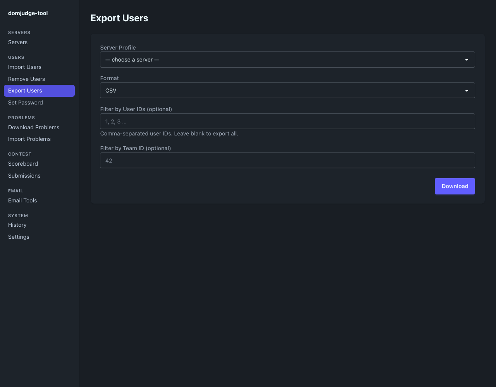

*桌面 HTML 預覽：透過 API 載入的使用者及隊伍選單可限制匯出範圍。圖中不包含
原生儲存對話框。*

1. 開啟 **Export Users**，選擇 profile。
2. 選擇 **CSV** 或 **JSON**。可選填 **User IDs** 及 **Team**；這些條件使用 ID，
   不使用使用者名稱。篩選留白時匯出所有使用者。
3. 按 **Download**。原生桌面版會開啟儲存對話框，請選擇目的地。建議檔名為
   `users-YYYYMMDD-HHMMSS.csv` 或 `users-YYYYMMDD-HHMMSS.json`。
4. 確認檔案確實存在。取消儲存不會建立檔案，表單仍可使用。在瀏覽器操作時，
   依該瀏覽器的下載行為處理。

收到附件回應後，表單仍會保留；再次點擊可能再產生一份匯出。這項操作只讀取
DOMjudge，不修改遠端資料。

CLI 對應操作明確指定輸出檔；省略 `-o` 時將資料寫到 stdout：

```bash
domjudge-tool -c tmp/operator/domserver.json export-users \
  -o tmp/operator/users.csv
domjudge-tool -c tmp/operator/domserver.json export-users \
  --format json --ids 1,2 --team-id 1 -o tmp/operator/users.json
```

工具會在本機再次套用使用者及隊伍篩選，涵蓋忽略隊伍篩選的 7.3.x 伺服器。
匯出包含即時使用者欄位，例如 ID、角色、啟用狀態，以及伺服器有提供的登入或
網路資料。`password` 欄只包含 DOMjudge 回傳的值，無法取回先前產生的明文密碼。
不要直接把這份匯出當成匯入或郵件帳密 CSV；其中額外欄位與該格式不相容。
兩種格式都必須保存在私人位置。

來源：[`internal/desktop/handler/export_users.go:50`](../internal/desktop/handler/export_users.go#L50)、
[`cmd/desktop/download_response.go:21`](../cmd/desktop/download_response.go#L21)、
[`internal/exporter/users.go:22`](../internal/exporter/users.go#L22)。

## 7. 重設密碼

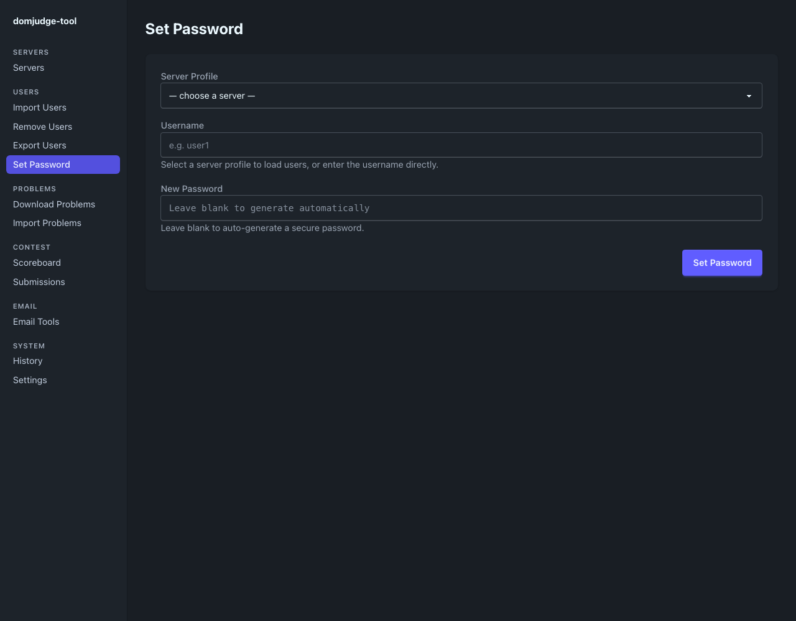

*桌面 HTML 預覽：選擇 profile 後從 API 載入使用者名稱；New Password 留白時，
會在實際重設時產生密碼。*

1. 開啟 **Set Password** 並選擇 profile。使用者名稱欄位會變成由 API 載入的
   選單，顯示名稱及使用者名稱。查詢失敗時，備用文字欄可輸入精確使用者名稱；
   這不會繞過實際操作讀取伺服器使用者資料的需求。
2. 選擇目標帳號。填寫 **New Password**，或留白以產生密碼。桌面欄位會明文顯示
   密碼。
3. 確認已授權後，按 **Set Password**。寫入成功後，在離開結果頁前，將
   **Generated Password** 或 **Password Set** 顯示的值複製到核准的私人儲存位置。
4. 用 **Set Another** 重設另一個帳號。History 沒有取回密碼的操作；遺失產生的
   密碼時，需要再次重設。

預設產生器使用 10 個英文字母及數字。需要明確指定長度或字元集時，請用 CLI。
密碼 pattern 是字元集，不是正規表示式；請見[密碼範例](SNIPPETS.zh-TW.md)。

以下指令**會修改指定帳號的密碼**，並將產生的值印到 stdout：

```bash
domjudge-tool -c tmp/operator/domserver.json set-password user1 \
  --password-length 16
```

請保護終端機紀錄及截圖。CLI 可能在嘗試寫入前就印出產生的密碼；必須確認成功
結束，才能認定重設完成。手動指定的 `--password` 可能出現在 shell 歷史紀錄
或程序參數。

使用者名稱查詢使用 REST API v4。密碼寫入依支援版本選擇路徑：通常 7.3.x 使用
API，8.3.1 使用 jury 頁面 scraper。明確指定 CLI 角色時，可能改選 scraper。
不要修改伺服器版本來繞過權限錯誤。

來源：[`internal/desktop/templates/set_password.templ:44`](../internal/desktop/templates/set_password.templ#L44)、
[`cmd/desktop/run_set_password.go:34`](../cmd/desktop/run_set_password.go#L34)、
[`internal/cli/users/set_password.go:67`](../internal/cli/users/set_password.go#L67)。

## 8. 下載題目套件

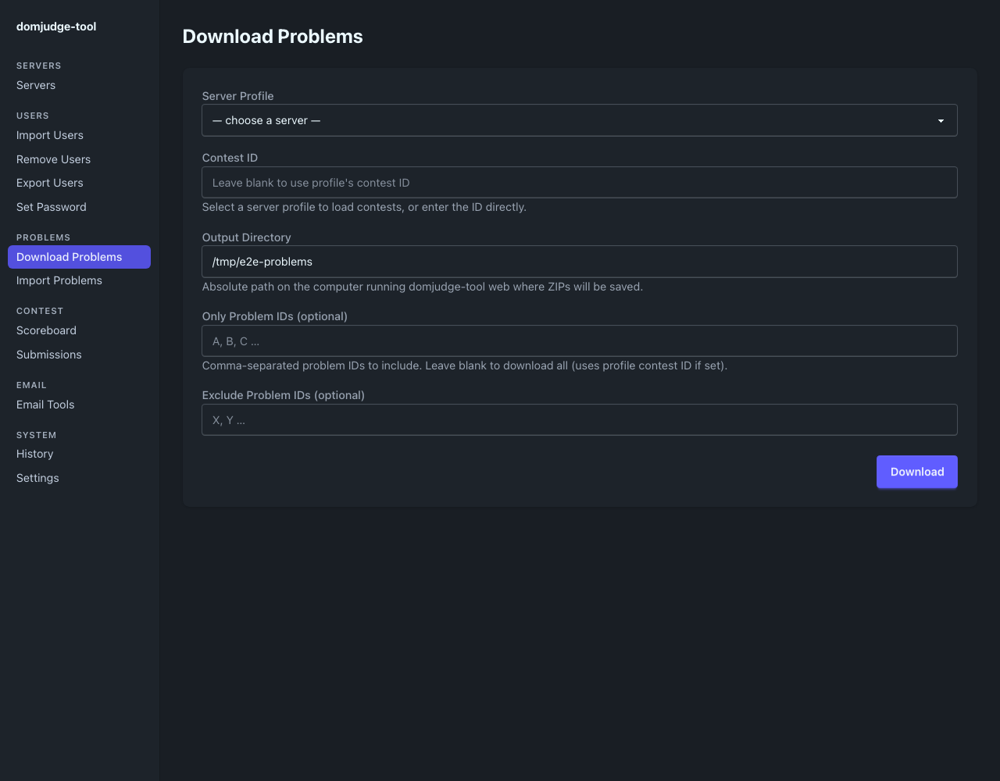

*桌面 HTML 預覽：競賽及題目篩選決定本機 ZIP 匯出範圍。真實應用程式中的
Browse 會開啟原生資料夾選擇器。*

1. 開啟 **Download Problems**，選擇 profile。
2. 選擇 **Contest**；API 選單退回文字欄位時，可輸入 ID。當次送出的競賽值
   優先於 profile；留白時使用 profile 已設定的競賽。
3. 設定絕對路徑的 **Output Directory**。**Browse…** 可選本機資料夾；取消時
   保留目前值。桌面預設為 `~/Downloads/export_problems`。
4. 可選填 **Only Problem IDs** 或 **Exclude Problem IDs**。載入的值會顯示為
   標籤；備用文字欄接受逗號分隔的 ID。
5. 按 **Download** 並等候結果。結果會顯示下載、略過數量及目的地；重用檔案前
   先檢查資料夾。

Only 留白且有設定競賽時，工具先透過 API 讀取該競賽的題目 ID，再由 jury UI
下載對應套件。未設定競賽或 Only 篩選時，scraper 可能讀取全站題目目錄。
API 範圍查詢失敗會中止操作；改用備用文字欄不代表下載能完全避開 API。請確認
實際 ID，不要只看畫面上的題目標籤。

CLI 對應操作使用設定檔的競賽：

```bash
domjudge-tool -c tmp/operator/domserver.json download-problems \
  --folder tmp/operator/problems
```

CLI 旗標為 `--folder`。預設是相對於工作目錄的 `export_problems`。
ZIP 檔名使用清理過的 `{id}_{name}.zip` 格式；已存在的同名檔可能被覆寫。
沒有匯出連結的題目會略過。CLI 的 **Processed … problems.** 數量包含略過項目，
請檢查實際 ZIP，不要把它當成檔案數。

來源：[`internal/desktop/handler/download_problems.go:154`](../internal/desktop/handler/download_problems.go#L154)、
[`cmd/desktop/run_download_problems.go:53`](../cmd/desktop/run_download_problems.go#L53)、
[`internal/cli/problems/download.go:54`](../internal/cli/problems/download.go#L54)。

## 9. 匯入或更新題目 ZIP

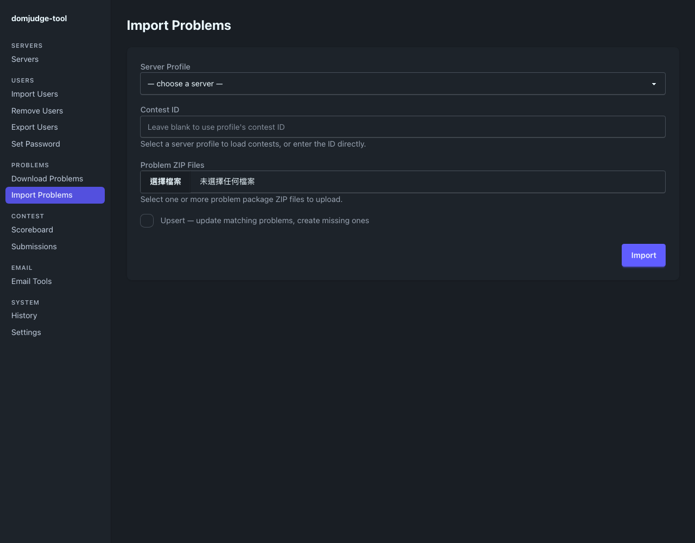

*桌面 HTML 預覽：真實應用程式中的 Import 會上傳題目套件。Upsert 可能覆寫
伺服器上符合的題目。*

1. 開啟 **Import Problems**，選擇目標 profile 及競賽。表單的競賽值優先於
   profile，兩處至少要有一處提供競賽。
2. 選擇一個或多個有效的 DOMjudge **Problem ZIP Files**。選取檔案本身不會匯入。
3. 要從套件中繼資料建立題目時，保持 **Upsert** 未勾選。只有確定要更新相符的
   競賽題目、並建立缺少的題目時才啟用。先備份可能被取代的套件。
4. 確認已授權遠端寫入後，按 **Import**，等候最終結果，再到 jury UI 確認
   競賽題目。

以下 CLI 範例是**擇一執行的遠端寫入**，不能當成連續的預覽指令。請選擇所需操作：

```bash
domjudge-tool -c tmp/operator/domserver.json import-problems \
  tmp/operator/problems
```

```bash
domjudge-tool -c tmp/operator/domserver.json import-problems \
  tmp/operator/problems --upsert
```

CLI 要求設定檔具有 `contest_id`，可接受單一 ZIP，或資料夾最上層的所有 `.zip`；
不會遞迴匯入子資料夾。成功會印出 **Imported … problems.** 若要明確更新某個
既有題目，CLI 也支援對單一 ZIP 指定 `--problem-id`。這個選項與 `--upsert`
互斥，桌面表單沒有提供。

Upsert 依設定競賽的題目清單比對。8.3.1 優先使用套件的 `externalid`，並以檔名
備用規則支援匯出後再匯入。7.3.x 使用檔名識別。身分有歧義時會在上傳前失敗。
若相同全站 external ID 已被所選競賽以外的題目使用，工具不會自動建立關聯或
刪除該題目。不要反覆重試新增，也不要猜測既有題目 ID；請到 jury UI 解決衝突。
識別規則請見 [CLI 參考](CLI.zh-TW.md)。

來源：[`internal/desktop/handler/import_problems.go:90`](../internal/desktop/handler/import_problems.go#L90)、
[`cmd/desktop/run_import_problems.go:39`](../cmd/desktop/run_import_problems.go#L39)、
[`internal/cli/problems/import.go:45`](../internal/cli/problems/import.go#L45)。

## 10. 匯出排行榜

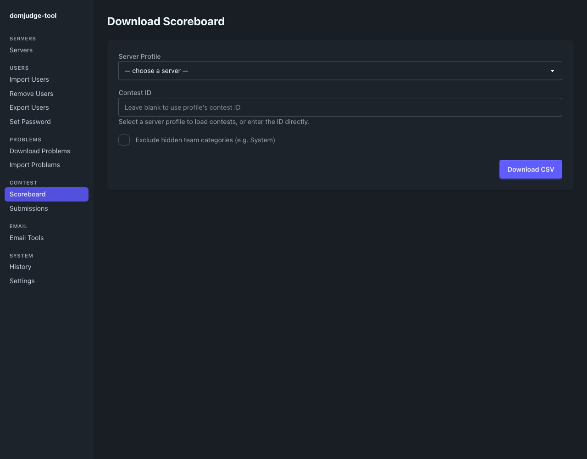

*桌面 HTML 預覽：Download CSV 產生檔案附件，真實原生應用程式接著詢問儲存位置。*

1. 開啟 **Scoreboard**，選擇 profile 及競賽。競賽留白時使用 profile 設定；
   兩者都留白時拒絕請求。
2. 只有確定要排除隱藏隊伍類別時，才勾選 **Exclude hidden team categories**。
   預設包含這些類別。
3. 按 **Download CSV**，在原生儲存對話框選目的地，再確認檔案已儲存。
   建議檔名為 `scoreboard-YYYYMMDD-HHMMSS.csv`。

CSV 前幾欄為 `Rank,TeamAffiliation,TeamName,SolvedCount,Score,Category`，
後面接題目標籤。各類別以分段排名呈現，每段的名次從 1 開始。工具重建的是
伺服器有提供的排行榜資料，無法揭露被公開榜或凍結政策隱藏的資訊。

CLI 對應操作寫入 `tmp/operator/scoreboard.csv`：

```bash
domjudge-tool -c tmp/operator/domserver.json download-scoreboard \
  --cid 1 --path tmp/operator --filename scoreboard
```

即使設定檔有 `contest_id`，仍必須提供 `--cid`。目的資料夾必須已存在；
`--filename` 後會加上 `.csv`。`--exclude-hidden` 套用相同的類別篩選。
CLI 成功時印出 **Wrote … (… rows).** 已存在的輸出檔可能被覆寫。

桌面版在開啟儲存對話框前，就將 CSV 產生結果寫入 History。因此取消儲存後，
可能留下已完成的 History 紀錄，卻沒有檔案。這項操作的 History 資料列數為零，
不代表排行榜沒有隊伍；請查看 CSV 本身。

來源：[`internal/desktop/handler/download_scoreboard.go:68`](../internal/desktop/handler/download_scoreboard.go#L68)、
[`internal/cli/scoreboard/download.go:59`](../internal/cli/scoreboard/download.go#L59)。

## 11. 下載繳交原始碼

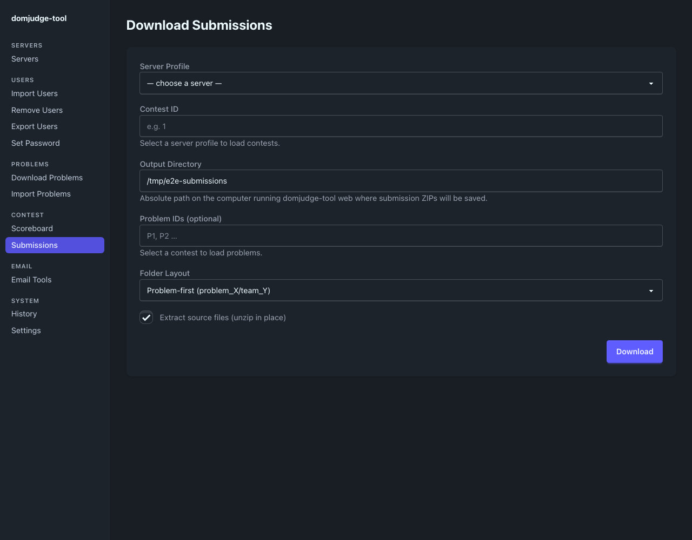

*桌面 HTML 預覽：下載機密原始碼封存檔前，先選專用目的地並檢查 Extract。*

1. 開啟 **Submissions**，選擇 profile，再明確選取或輸入競賽。profile 的競賽
   可在 API 選單有相符選項時自動帶入，但送出表單仍必須包含競賽值。
2. 用文字欄或 **Browse…** 選擇絕對路徑的 **Output Directory**。桌面目前預設
   與題目下載共用 `~/Downloads/export_problems`；請改成專用的繳交資料夾，
   避免混放產物。
3. 可用 **Problem IDs** 限制桌面下載的題目。
4. 選擇 **Folder Layout**，並決定是否保留完整 ZIP。
5. 按 **Download**，等候完成後檢查輸出檔及 History。下載不會執行或評測原始碼。

| 排列方式 | 所選輸出路徑下的資料夾 |
| --- | --- |
| 題目優先，預設 / mode `2` | `problem_{problem-shortname}/team_{team-name}` |
| 隊伍優先 / mode `1` | `team_{team-name}/problem_{problem-shortname}` |
| 競賽資料夾 / mode `0` | `contest_{contest-id}` |

封存檔使用 `{judgement}_{submission-id}.zip`；找不到對應評測結果時使用 `none`。
無法對應到競賽隊伍或題目索引的繳交會略過。

> **Extract source files** 預設勾選。相容行為只保留每個封存檔中依字母排序的
> 第一個一般檔案，改以評測結果及繳交 ID 命名，成功後刪除該 ZIP。需要保留完整
> 多檔案繳交內容時，取消桌面 Extract，或在 CLI 使用 `--extract=false`。

保留完整封存檔的 CLI 對應操作：

```bash
domjudge-tool -c tmp/operator/domserver.json download-submissions 1 \
  --path tmp/operator/submissions --mode 2 --extract=false
```

競賽 ID 是位置參數。`--path` 加在目錄排列之前，省略時從目前工作目錄開始。
CLI 印出 **Downloaded … submissions.** 題目 ID 篩選目前僅提供於桌面控制項，
不要自行假設存在 CLI 題目篩選旗標。每次快照使用新目的地，避免取代舊檔案。
原始碼及隊伍名稱都應視為私人資料。

來源：[`internal/desktop/handler/download_submissions.go:84`](../internal/desktop/handler/download_submissions.go#L84)、
[`internal/submissions/download.go:68`](../internal/submissions/download.go#L68)、
[`internal/submissions/extract.go:24`](../internal/submissions/extract.go#L24)。

## 12. 準備與寄送帳密郵件

### 12.1. 選擇安全的交付流程

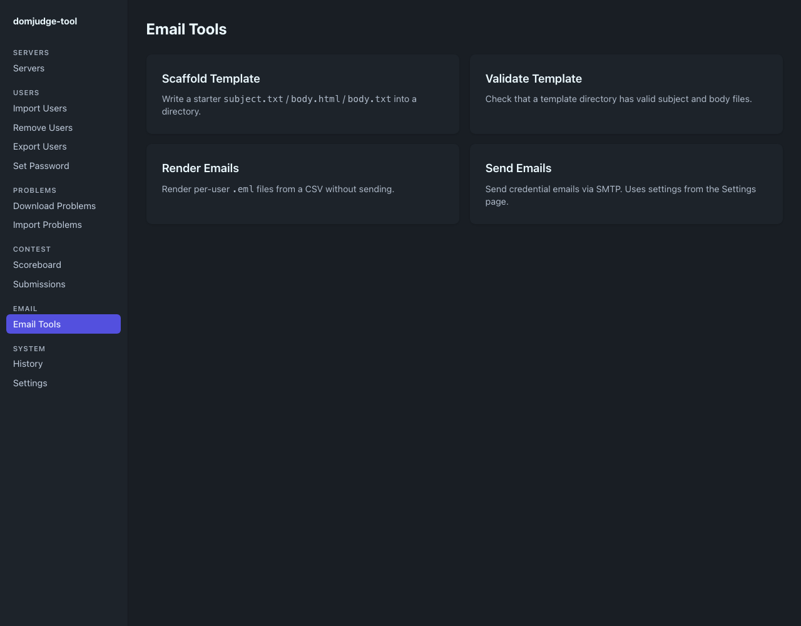

*桌面 HTML 預覽：前三項工具處理本機產物；真實應用程式中的 Send Emails
會實際透過 SMTP 寄信。*

依序執行**建立範本 → 編輯 → 驗證 → 轉出郵件 → 檢查 → 授權 → 寄送**。
交付帳密時，優先使用 CLI 匯入，再用明確指定設定檔及 From 位址的 CLI 轉出郵件。
這樣可保留實際密碼，也能將正確的伺服器網址提供給範本。

使用成功 CLI 匯入產生的帳密 CSV，或已私下保留且密碼確定有效的 CSV。郵件指令
不會讀取伺服器密碼、不會產生遺漏密碼，也不會重設 DOMjudge 帳號。CSV 密碼留白，
郵件就會呈現空白。**Export Users** 不能取代這份帳密 CSV。

範本變數為 `$username`、`$name`、`$email`、`$affiliation`、`$password` 及
`$server_host`。必須有 `subject.txt`，並提供 `body.html` 或 `body.txt`；
兩者都有時優先用 HTML。驗證檢查實際載入的主旨、內文及支援變數，不會保證
收件位址、密碼、授權或投遞正確。

### 12.2. 在本機建立、驗證與轉出郵件

在 **Email Tools** 操作：

1. **Scaffold Template**：填入私人絕對路徑的 **Template Directory**，按
   **Write Scaffold**。工具建立 `subject.txt`、`body.html` 及 `body.txt`。
   只有確定要取代檔案時才勾選 **Overwrite existing files**。接著用文字編輯器
   修改範本。
2. **Validate Template**：填入同一資料夾，按 **Validate**。閱讀成功訊息，或
   修正回報的範本錯誤。
3. **Render Emails**：填入 **CSV File**、**Template Directory** 及
   **Output Directory** 的絕對路徑，按 **Render**。CSV 欄位是本機檔案路徑，
   沒有上傳選擇器。除非啟用覆寫，否則不會取代已有的 `.eml`。

桌面轉出目前固定以 `noreply@localhost` 作為 From，並使用空的伺服器設定，
因此 `$server_host` 為空白。桌面寄送同樣提供空白 `$server_host`，但 From
取自 Settings。郵件工具沒有 server-profile 選單。範本需要設定中的 DOMjudge
網址時，請使用下方 CLI；不要假設預設桌面 profile 會填入這個變數。

只處理本機資料的 CLI 準備步驟：

```bash
domjudge-tool email-template-example -o tmp/operator/email-template
domjudge-tool email-template-validate tmp/operator/email-template
domjudge-tool -c tmp/operator/domserver.json render-user-accounts \
  tmp/operator/import-users-teams-out.csv tmp/operator/email-template \
  --output-dir tmp/operator/rendered-emails \
  --from-email contest@example.org
```

建立範本後、驗證前先編輯。`email-template-example` 印出資料夾路徑；驗證成功
會印出 **template OK:**。轉出工具寫入 `{safe-username}.eml`，並印出
**Rendered … emails to …**，不連線 SMTP。它仍需要 CLI 設定來填入 `$server_host`。

以上設定的網址已含協定，使用前請編輯兩份範本內文，將 `https://$server_host`
改成 `$server_host`。原始範本自行加上 `https://`，保留會產生無效的
`https://https://…` 連結。範本驗證檢查替代變數，不檢查網址是否正確。

開啟 `.eml` 檢查，但不要寄送。確認 From、To、伺服器網址、使用者名稱及實際
密碼。CSV 缺少 email 時，工具改用 `{username}@{From-domain}`，不會略過該列。
請明確填妥所有已核准的收件地址，避免寄到不預期的備用地址。轉出的郵件包含
帳密，輸出資料夾必須保持私人。

### 12.3. 設定 SMTP 並授權實際寄送

在 **Settings** 儲存 SMTP **Host**、**Port**、**From Email**，以及選填的
**Username** / **Password**。這些帳密屬於郵件伺服器，與 DOMjudge 分開。
只有使用者名稱及密碼都非空白時，才嘗試 AUTH。

Settings 的 **Use TLS** 與 CLI 的 `--use-ssl` 都代表**連線時立即使用 TLS**，
常見連接埠為 465。**目前沒有實作 STARTTLS**；若伺服器要求在 587 使用
STARTTLS，這個傳輸實作無法配合。不要關閉 TLS 來繞過不相容。明文 SMTP 可能
暴露 AUTH 帳密及郵件內容。

> **Send** 沒有 dry-run，也沒有額外的最終確認視窗。核對收件人、範本、帳密、
> 主機、連接埠及 TLS 模式，取得授權後才能點擊。它會重新讀取 CSV 與範本，
> 產生新的郵件寄送，不會寄出先前檢查的 `.eml` 檔。請保持已檢查的輸入不變。

桌面版開啟 **Send Emails**，填入 CSV 與範本資料夾路徑，只有在已授權時才按
**Send**。保持進度頁開啟。第一個錯誤會中止批次；前面的郵件可能已被 SMTP
接受。再次執行前，先確認錯誤及已寄送對象，避免重複寄信。

以下 CLI 替代操作**會實際寄信**。請依核准程序私下設定 `SMTP_PASSWORD`；
shell 檢查會拒絕空值。變數展開後仍會出現在程序參數，不要錄製或分享含機密的
呼叫內容：

```bash
domjudge-tool -c tmp/operator/domserver.json send-user-accounts \
  tmp/operator/import-users-teams-out.csv tmp/operator/email-template \
  --host smtp.example.org --port 465 --use-ssl \
  --smtp-username mailer \
  --smtp-password "${SMTP_PASSWORD:?Set SMTP_PASSWORD locally}" \
  --from-email contest@example.org --timeout 30s
```

成功會印出 **Sent … emails.** SMTP 接受郵件不代表已送達收件匣，請依郵件系統
核准的作業程序確認。不要把正式收件清單當成無害示範。

來源：[`cmd/desktop/run_email_tools.go:32`](../cmd/desktop/run_email_tools.go#L32)、
[`internal/email/template.go:20`](../internal/email/template.go#L20)、
[`internal/email/send.go:44`](../internal/email/send.go#L44)、
[`internal/email/smtp.go:65`](../internal/email/smtp.go#L65)、
[`internal/cli/emails/send_user_accounts.go:95`](../internal/cli/emails/send_user_accounts.go#L95)。

## 13. 閱讀操作 History

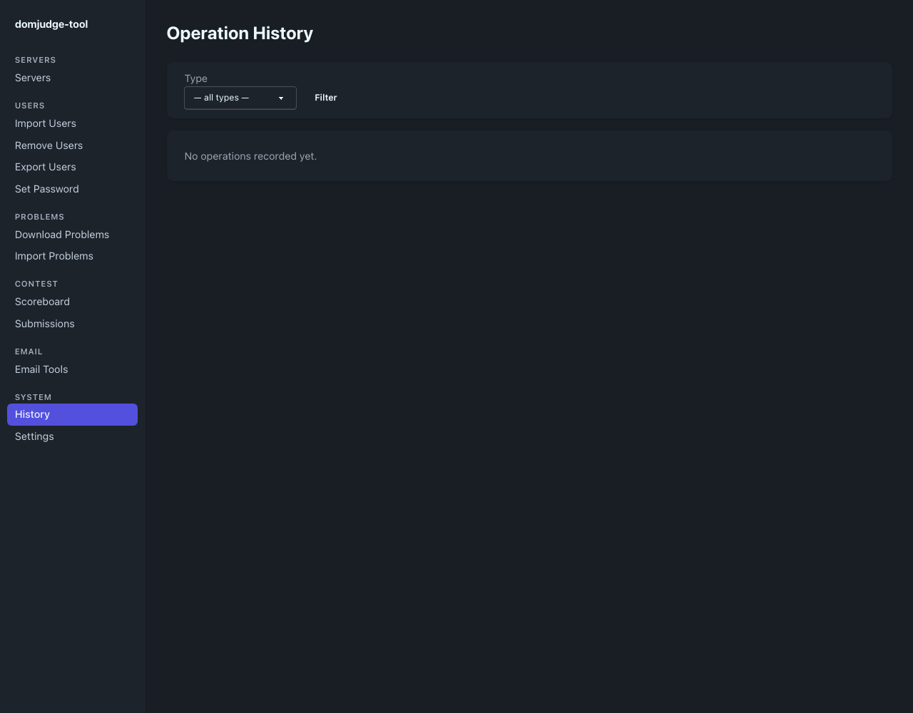

*桌面 HTML 預覽：擷取期間未執行操作，因此 History 為空白。類型篩選位於本機操作紀錄上方。*

開啟 **History**，查看已記錄的桌面匯入、移除、題目傳輸、排行榜產生、繳交下載
及郵件寄送。用 **Type → Filter** 限制操作類型，再用 **Clear** 清除篩選。
**Detail →** 可查看時間、狀態、資料列數、錯誤、摘要及已儲存的參數。

- `RUNNING` 表示紀錄尚未寫入最終結果，不保證背景工作仍在執行。
- `DONE` 表示該操作程式路徑回報完成。需要時，另行確認本機檔案及遠端狀態。
- `ERROR` 包含失敗訊息；前面的修改或寄送仍可能已生效。

Type 選單列出六種帳號、題目及競賽操作。未篩選清單仍可能出現郵件寄送紀錄，
但選單沒有郵件寄送選項。郵件操作沒有 server profile，Server 欄可能留白。

History 屬於桌面資料庫，不是完整的 DOMjudge 稽核紀錄。它不收集 CLI 執行、
使用者匯出、密碼值或重設、profile 編輯，也不收集本機郵件建立範本、驗證或轉出。
資料列數依操作而異，不一定等於使用者、檔案或排行榜列數。History 沒有復原、
續作或自動重試控制項。

保持進度頁開啟，直到出現最終結果。工作綁定於當次連線請求，沒有持久化工作佇列。
若頁面關閉或應用程式停止，重新送出前先檢查 History、輸出及遠端狀態。不要重新
整理舊進度頁來取回結果；這可能重新連到操作端點，而非單純顯示稽核紀錄。

來源：[`internal/desktop/templates/history.templ:17`](../internal/desktop/templates/history.templ#L17)、
[`internal/desktop/handler/history.go:20`](../internal/desktop/handler/history.go#L20)、
[`internal/desktop/handler/email_tools.go:241`](../internal/desktop/handler/email_tools.go#L241)。

## 14. Settings、本機資料與帳密保護

### 14.1. 儲存偏好及 SMTP 設定

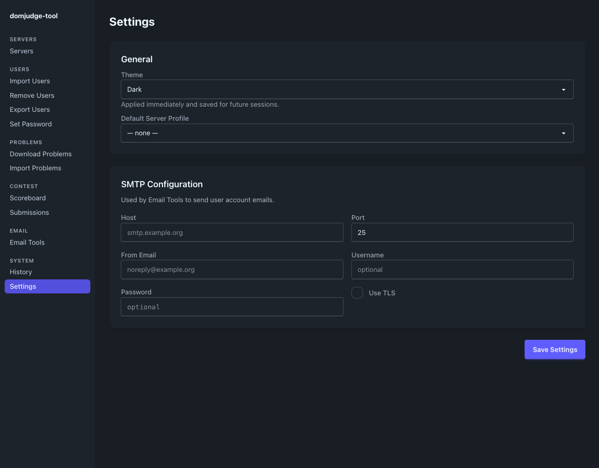

*桌面 HTML 預覽：設定儲存在本機。圖片不含真實 SMTP 帳密或私人伺服器設定。*

**Settings** 提供 **Dark**、**Light**、**System** 主題，
**Default Server Profile** 偏好設定及 SMTP 設定。切換主題會立即透過本機
瀏覽器儲存套用；按 **Save Settings** 才將設定表單儲存到 SQLite。若 System
在所用平台沒有呈現預期外觀，請明確選擇 Dark 或 Light。

預設 profile 偏好、Servers 的預設標記及當次操作選取的 profile 不能互換。
每次都要明確選擇操作 profile。儲存前核對 SMTP 主機、連接埠、From 位址及 TLS
模式；寄送使用這些已儲存設定。這個表單沒有測試郵件按鈕，也不驗證 SMTP 連線。

### 14.2. 尋找與保護本機資料

| 資料 | 位置或行為 |
| --- | --- |
| CLI 連線設定 | `--config` 指定的路徑，否則使用工作目錄的 `domserver.json` |
| CLI 匯入帳密 | 工作目錄的 `import-users-teams-out.csv` |
| 桌面 profiles、SMTP 設定、History | 作業系統使用者設定目錄下的 `domjudge-tool/domjudge-tool.db` |
| macOS 桌面資料庫 | `~/Library/Application Support/domjudge-tool/domjudge-tool.db` |
| Linux 桌面資料庫 | 通常為 `~/.config/domjudge-tool/domjudge-tool.db`，或位於 `XDG_CONFIG_HOME` 下 |
| Windows 桌面資料庫 | 通常為 `%AppData%\domjudge-tool\domjudge-tool.db` |
| 桌面主題 | 內嵌瀏覽器的本機儲存鍵 `dj-theme`，以及已儲存的設定偏好 |
| 匯入上傳檔 | 操作所需的暫存 CSV / ZIP；串流正常清理時會移除 |
| 匯出與郵件 | 選定檔案或輸出資料夾；完成後不會自動移除 |

無法取得作業系統設定目錄時，桌面版可能改用工作目錄中的路徑。不要直接認定資料
遺失，先檢查啟動錯誤及實際儲存位置。原始碼建置的執行檔與應用程式套件使用
相同的作業系統使用者資料庫路徑。

> 桌面的 DOMjudge 及 SMTP 密碼以明文字串儲存在 SQLite，沒有應用程式層級加密，
> 也沒有整合 Keychain 或憑證保管庫。遮蔽的密碼欄位只控制顯示。CLI JSON、
> 帳密 CSV、`.eml`、資料庫備份、SQLite WAL 附屬檔及紀錄也可能洩漏機密或個資。

使用私人作業系統帳號、限制資料夾權限，並加密儲存裝置及備份。範例設定
`umask 077`；不要假設每個輸出寫入器都會獨立強制私人權限。備份資料庫前先關閉
應用程式，並用了解 SQLite 的程序處理資料庫及仍存在的 `-wal` / `-shm`。
複製資料庫也會帶走其中的帳密及操作紀錄。刪除 profile 不等於安全抹除備份或
舊資料庫頁面。

保護本機 loopback 服務；應用程式執行時，避免讓不受信任的本機程序共用工作站。
敏感輸出應放在追蹤原始碼以外，或忽略的 `tmp/` 下；被忽略不代表已加密。
不要把未去識別化的截圖或終端機紀錄附到 issue。

來源：[`cmd/desktop/main.go:113`](../cmd/desktop/main.go#L113)、
[`internal/desktop/profile/store.go:18`](../internal/desktop/profile/store.go#L18)、
[`internal/desktop/settings/store.go:12`](../internal/desktop/settings/store.go#L12)、
[`internal/desktop/templates/settings.templ:27`](../internal/desktop/templates/settings.templ#L27)、
[`internal/desktop/db/db.go:26`](../internal/desktop/db/db.go#L26)。

## 15. 疑難排解

| 狀況 | 處理方式與限制 |
| --- | --- |
| CLI 找不到設定檔 | 檢查工作目錄，或用明確的 `-c` 路徑。桌面 profiles 不會建立 CLI JSON。 |
| `version` 成功，但操作無法連線 | `version` 只提供本機建置資訊。在不分享帳密的前提下，確認主機、網路、API 權限及 jury 登入權限。 |
| Profile 已儲存，選單或寫入仍失敗 | 儲存 profile 不會測試連線。先用 Export Users 檢查主機、版本及帳密；jury 寫入可能需要額外權限。 |
| 競賽、使用者、題目或隊伍選單載入失敗 | 閱讀警告並確認 profile。只有確定精確 ID 或使用者名稱時才用備用文字欄。實際操作仍可能需要同一 API。 |
| `contest_id is required` | 題目匯入或排行榜請在表單或 profile 設定競賽。Submissions 必須送出競賽值；排行榜 CLI 一律需要 `--cid`。 |
| CSV 標頭、資料列或重複錯誤 | 重新產生標準範本、保留標頭、替換範例資料，再修正指定資料列。不要新增 `team` 欄。 |
| 桌面匯入成功，但找不到帳密 CSV | 桌面匯入不會產生該檔案。使用已保留的明確密碼，或重設帳號。未來需交付帳密時改用 CLI 匯入；不要盲目重複匯入。 |
| 匯出沒有密碼，或不能重新匯入 | Export Users 回傳即時使用者欄位，格式與帳密 CSV 不同。保留成功 CLI 匯入的輸出以交付帳密；未知密碼需重設。 |
| 取消儲存，或 History 完成卻沒有檔案 | 取消不會建立檔案。排行榜在儲存前就記錄產生結果。選擇有效目的地，並自行確認檔案存在。 |
| 無法建立輸出 | 使用可寫入的私人路徑。先建立排行榜 CLI 的輸出資料夾。不要依賴 macOS 套件的工作目錄。 |
| 題目下載數量與 ZIP 數量不同 | Processed 包含沒有匯出連結而略過的項目。確認競賽範圍並檢查實際 ZIP。 |
| 題目匯入回報 external ID 重複 | 檢查所選競賽及全站題目目錄。Upsert 不會自動關聯全站重複題目；不要猜更新目標。 |
| 繳交下載遺失其他原始碼檔 | 預設解壓縮只保留一個檔案並移除 ZIP。改用新資料夾，取消 Extract 或加上 `--extract=false` 重新下載。 |
| 桌面郵件的 `$server_host` 留白 | 桌面郵件工具沒有傳入 server profile。優先用明確設定檔執行 CLI render/send，或有意識地修改範本中的伺服器文字。 |
| SMTP 在 587 失敗 | 確認伺服器是否要求 STARTTLS。工具只支援連線時 TLS 或明文 SMTP；請使用已核准且相容的端點。 |
| 失敗前已有部分收件人收到郵件 | 寄送在第一個錯誤停止，不會撤回前面的 SMTP 寄送。重試前先核對收件紀錄，避免重複寄送。 |
| 桌面與瀏覽器主題不同 | 主題的本機儲存屬於各自瀏覽器或 webview。請在該介面選主題並儲存 Settings；必要時明確選 Dark 或 Light。 |
| 桌面啟動回報 9900 已被使用 | 關閉已執行的執行個體或處理連接埠衝突。不要同時啟動多個執行個體，也不要對外公開服務。 |
| 關閉頁面或程式後，History 一直是 RUNNING | 再次寫入前先檢查伺服器及輸出檔。History 不會自動續作中斷的操作。 |

CLI 診斷可加 `-v` 查看路由資訊，或用 `-vv` 取得除錯紀錄，並保持輸出私人。
回報時提供指令名稱、工具建置版本、設定的 DOMjudge 版本、預期結果、實際錯誤及
已去識別化的重現方式。分享證據前，移除密碼、收件人、學生或隊伍資料、真實網址、
IP、cookie 及檔案內容。

## 16. 參考資料與手冊維護

- [CLI 參考](CLI.zh-TW.md)：標準旗標、設定欄位、路由、CSV 格式及完整題目識別規則。
- [CLI 範例](SNIPPETS.zh-TW.md)：其他可複製再修改的指令。
- [快速開始](../README.md)：最短的安裝及首次操作路徑。
- [文件產製契約](DOCUMENTATION.md)：去識別化截圖、雙語結構及隔離的 AI 文件審查。

本手冊依儲存庫中的指令接線與桌面表單說明，明確區分唯讀預覽、本機儲存、遠端
修改，以及已確認的檔案或 SMTP 結果。行為改變時，同步更新兩個語言版本，並依
文件產製流程，只重新擷取使用保留範例資料的預覽截圖。
